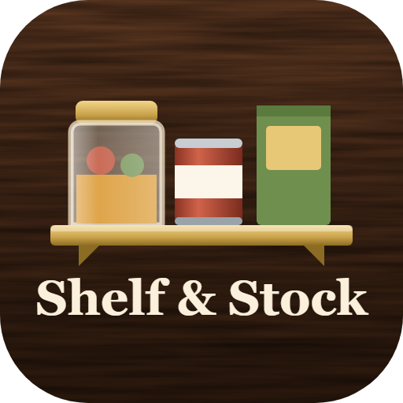

# Shelf & Stock



**Your whole kitchen in your pocket.** See exactly what's in the fridge, freezer, every cabinet and the garage, keep a smart shopping list, plan meals and gatherings on a calendar, and cook with what you already have. Modern wood-grain UI, offline-first, with an Android app.

**Live:** https://shelfandstock.vercel.app · **Docs:** [Wiki](https://github.com/real-CAK3D/ShelfandStock/wiki)

## Features

- **Walk-around kitchen** – swipe between the stove wall, sink wall and corner/island; swipe right from the stove for the garage. Every door and drawer opens to its shelves, drawn from a real kitchen.
- **French-door fridge** – door bins on each side, shelves, cheese drawer and crispers; the bottom freezer drawer has its slide-out tray and deep basket.
- **Real dates** – Best by / Use by / Sell by per batch, restocking adds a new batch, "Label this shelf" walks a shelf one item at a time. Estimated dates show `≈` until you label them (estimates from USDA FoodKeeper guidance).
- **Shopping list** – grouped by aisle, smart "you should get" suggestions, check off in the store, then *Put away* moves everything into the kitchen and asks for the dates.
- **Recipes** – 38 built-in plus TheMealDB online; ranked by what you have, quantity-aware ("need 1 lb more"), add only what's missing, scale servings, "I cooked this" takes it out of stock.
- **Calendar** – meals, gatherings and holidays; guests scale recipes; prep tips like turkey thaw dates; tagged holiday items show where they're stored.
- **Real product labels** – barcode scan → Open Food Facts label, Nutrition Facts panel, Nutri-Score, allergens.
- **People & PINs** – Andrew, Zayne, Gemmie and Poppy sign in with their own 4-digit PIN (first time 0000); everything is signed ("Andrew requested coffee").
- **Store runs & live activity** – "Poppy is going to Hannaford Thursday, list closes at noon", "Poppy is at Hannaford" via saved local stores, and a live panel of who is in the app doing what.
- **Snap a photo** – barcode in the photo → real label; otherwise a free on-phone AI (TensorFlow.js MobileNet) identifies the food. Keep your photo or the app picture.
- **Receipts & prices** – scan a receipt (on-phone OCR) to save prices per store; see the cheapest store for each item and an estimated trip total.
- **Read dates off packages** – point the camera at "BEST BY 03/14/27" and the date and type fill in.
- **This week** – spending, waste (and its cost), meals cooked and who pitched in.
- **Notifications & widget (Android)** – background notices for store runs, "at the store", requests and run-outs, with a "list closes soon" reminder; a home-screen widget with the list and what to use soon.
- **3D icons** – Microsoft Fluent Emoji 3D bundled offline (or use the phone emoji).
- **Clyde** – water bowl, food bowl and a bone for his treats.
- **Holiday themes** – automatic seasonal colors and decorations (or pick one / turn off).
- **Household sync** – share one kitchen across phones with a household code (Supabase).
- **Help mode** – tap **?** then anything on screen to learn what it does. Guided walkthrough on first launch.

## Project layout

```
www/                 the app (vanilla JS modules, no build step)
  js/data/           food catalog, recipes, holidays, kitchen layout
  js/views/          kitchen, stock, recipes, plan, list, settings
  js/ui/             sheets, item editor, labels, tour, help mode
  js/services/       Open Food Facts, TheMealDB, household sync
android/             WebView wrapper that bundles www/ into an APK
supabase/            SQL for the household-sync schema
```

## Run it

```bash
npx http-server www -p 5290 -c-1
```

## Android

```bash
android/build.sh
```

Produces `dist/ShelfAndStock-<version>.apk`. The APK serves `www/` from inside the app (works offline) and adds native bridges for camera permission, sharing, saving backups and CORS-free label search.

## Data sources

Product labels & nutrition: [Open Food Facts](https://world.openfoodfacts.org) (ODbL) · Online recipes: [TheMealDB](https://www.themealdb.com) · Storage times adapted from USDA FoodKeeper guidance.
